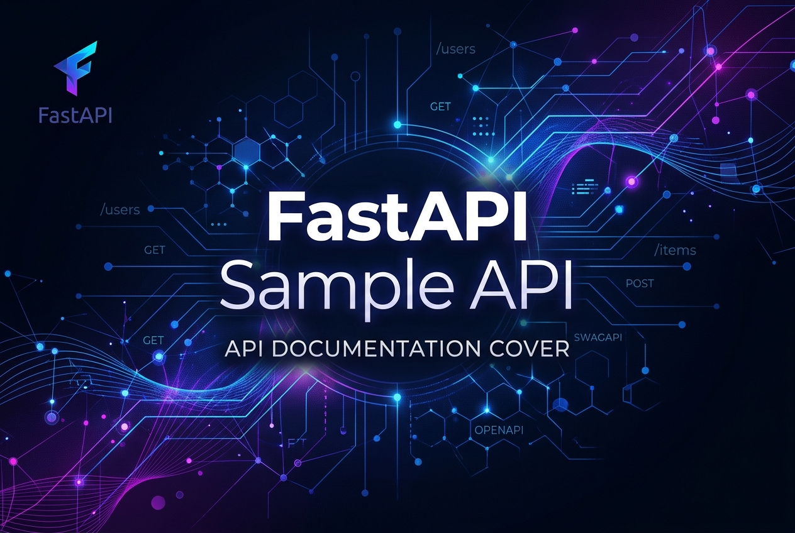

# FastAPI Sample API



## Project Overview
This project demonstrates a minimal FastAPI application with:
- Automatic Swagger UI documentation (`/docs`).
- Health‑check endpoint (`/health`).
- Live‑reload during development (`--reload`).
- Version‑pinned dependencies for reproducible builds.

## Quick Start
```powershell
# 1. Create a virtual environment (run in the project root)
python -m venv venv

# 2. Activate the virtual environment
.\venv\Scripts\activate

# 3. Install dependencies (pinned versions)
pip install -r requirements.txt

# 4. Run the development server with auto‑reload
uvicorn main:app --reload --port 8000
```

Open your browser at `http://127.0.0.1:8000/docs` to explore the interactive Swagger UI.

## Files
- `main.py` – FastAPI application entry point.
- `requirements.txt` – Pin‑pinned dependencies.
- `README.md` – This documentation.
- `venv/` – Virtual environment (created after step 1).
